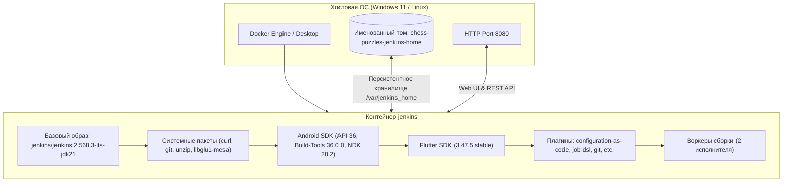
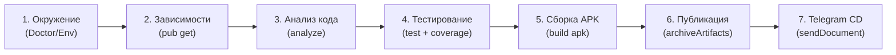

# МИНИСТЕРСТВО НАУКИ И ВЫСШЕГО ОБРАЗОВАНИЯ РОССИЙСКОЙ ФЕДЕРАЦИИ
## Федеральное государственное бюджетное образовательное учреждение высшего образования
## «МИРЭА — Российский технологический университет» (РТУ МИРЭА)

### Институт информационных технологий
### Кафедра корпоративных информационных систем

<br><br><br>

# КУРСОВАЯ РАБОТА
### по дисциплине «Настройка и администрирование сервисного программного обеспечения»

**Тема:** «Настройка и администрирование CI/CD процесса для мобильного приложения»

<br><br><br>

**Выполнил:**  
Студент группы ИКБО-15-25  
Платонов В.  

**Руководитель работы:**  
Преподаватель Волков М. В.  

<br><br><br>

**Москва 2026**

---

## СОДЕРЖАНИЕ

- [ВВЕДЕНИЕ](#введение)
- [1. АНАЛИТИЧЕСКАЯ ЧАСТЬ](#1-аналитическая-часть)
  - [1.1. Специфика CI/CD для мобильных платформ](#11-специфика-cicd-для-мобильных-платформ)
  - [1.2. Сравнительный анализ сервисного ПО для непрерывной интеграции](#12-сравнительный-анализ-сервисного-по-для-непрерывной-интеграции)
  - [1.3. Обоснование стека технологий](#13-обоснование-стека-технологий)
- [2. ПРОЕКТИРОВАНИЕ АРХИТЕКТУРЫ СЕРВИСНОГО ПО](#2-проектирование-архитектуры-сервисного-по)
  - [2.1. Контейнеризация и изоляция сборочной среды](#21-контейнеризация-и-изоляция-сборочной-среды)
  - [2.2. Конфигурация как код (Jenkins Configuration as Code)](#22-конфигурация-как-код-jenkins-configuration-as-code)
  - [2.3. Архитектура конвейера сборок (Pipeline as Code)](#23-архитектура-конвейера-сборок-pipeline-as-code)
- [3. ПРАКТИЧЕСКАЯ РЕАЛИЗАЦИЯ И АДМИНИСТРИРОВАНИЕ](#3-практическая-реализация-и-администрирование)
  - [3.1. Сборка базового Docker-образа с Android SDK и Flutter SDK](#31-сборка-базового-docker-образа-с-android-sdk-и-flutter-sdk)
  - [3.2. Автоматическое создание заданий через Job DSL](#32-автоматическое-создание-заданий-через-job-dsl)
  - [3.3. Реализация стадий конвейера в Jenkinsfile](#33-реализация-стадий-конвейера-в-jenkinsfile)
  - [3.4. Управление секретами и уведомлениями (Telegram Bot API)](#34-управление-секретами-и-уведомлениями-telegram-bot-api)
- [4. ТЕСТИРОВАНИЕ, ЭКСПЛУАТАЦИЯ И АДМИНИСТРИРОВАНИЕ](#4-тестирование-эксплуатация-и-администрирование)
  - [4.1. Автоматизированное тестирование мобильного приложения](#41-автоматизированное-тестирование-мобильного-приложения)
  - [4.2. Верификация механизма отлова регрессий (отрицательное тестирование)](#42-верификация-механизма-отлова-регрессий-отрицательное-тестирование)
  - [4.3. Резервное копирование и аварийное восстановление (Disaster Recovery)](#43-резервное-копирование-и-аварийное-восстановление-disaster-recovery)
- [ЗАКЛЮЧЕНИЕ](#заключение)
- [СПИСОК ИСПОЛЬЗОВАННЫХ ИСТОЧНИКОВ](#список-использованных-источников)
- [ПРИЛОЖЕНИЯ](#приложения)

---

## ВВЕДЕНИЕ

**Актуальность темы.** В современной разработке программного обеспечения методологии непрерывной интеграции (Continuous Integration, CI) и непрерывной доставки (Continuous Delivery, CD) являются стандартом индустрии. Для мобильных платформ (в частности, Android) процесс сборки и тестирования сопряжён с повышенной ресурсоёмкостью и зависимостью от комплексного окружения: Java Virtual Machine, Android SDK, Gradle, NDK, а также инструментариев кроссплатформенных фреймворков (Flutter). 

Ручная сборка дистрибутивов (APK/AAB) разработчиками на локальных рабочих станциях приводит к эффекту «it works on my machine», рассинхронизации версий сборочных утилит, утечке времени высококвалифицированных специалистов и задержке доставки релизов тестировщикам. Внедрение специализированного сервисного программного обеспечения (CI/CD серверов), изолированного в контейнерах и управляемого как код, решает данную проблему.

**Цель работы:** Проектирование, развёртывание, настройка и практическое администрирование отказоустойчивого и воспроизводимого CI/CD процесса для мобильного приложения с автоматическим анализом кода, многоуровневым тестированием, генерацией релизных артефактов и доставкой конечному потребителю.

**Задачи работы:**
1. Провести сравнительный анализ существующих систем CI/CD и обосновать выбор инструментария для локального и защищённого развёртывания.
2. Спроектировать контейнеризированную инфраструктуру на базе Docker и Docker Compose.
3. Реализовать парадигму «Configuration as Code» (JCasC) для исключения ручных настроек сервера через веб-интерфейс.
4. Разработать декларативный конвейер (`Jenkinsfile`) со стадиями верификации окружения, аудита зависимостей, статического анализа кода, выполнения тестов с замером покрытия, сборки оптимизированного APK и доставки артефакта.
5. Разработать целевое мобильное приложение и комплекс модульных и интеграционных тестов.
6. Разработать регламенты системного администрирования: мониторинг состояния, управление логами, резервное копирование и восстановление после сбоев.

---

## 1. АНАЛИТИЧЕСКАЯ ЧАСТЬ

### 1.1. Специфика CI/CD для мобильных платформ

Процесс непрерывной интеграции для мобильных приложений имеет ряд фундаментальных отличий от классических backend- и web-сервисов:
1. **Громоздкость сборочного стека:** Требуется наличие установленного Android SDK Build-Tools, Platform-Tools, системных образов API, NDK и сопутствующих библиотек компиляции C/C++.
2. **Лицензирование компонентов:** Инструменты командной строки Android SDK (`sdkmanager`) требуют предварительного автоматического принятия лицензионных соглашений Google (`yes | sdkmanager --licenses`).
3. **Версионирование артефактов:** Каждая сборка требует уникального целочисленного `versionCode`, необходимого операционной системе Android для корректного обновления приложения поверх установленного. В ручном режиме это приводит к коллизиям; в CI-конвейере параметр должен динамически инъецироваться из переменной окружения `BUILD_NUMBER`.
4. **Специфика доставки:** В отличие от развёртывания веб-сервера на проде, мобильный артефакт (APK) должен доставляться либо во внутренний канал тестирования (Telegram-боты, Firebase App Distribution), либо в сторы (Google Play, RuStore).

### 1.2. Сравнительный анализ сервисного ПО для непрерывной интеграции

| Критерий | Jenkins | GitLab CI | GitHub Actions |
|---|---|---|---|
| **Тип развёртывания** | Self-hosted (On-premise / Cloud) | SaaS / Self-hosted | Преимущественно Cloud SaaS |
| **Независимость от внешних каналов** | Полная (работает в закрытом контуре) | Зависит от лицензии GitLab Server | Зависит от доступности серверов GitHub |
| **Стоимость эксплуатации** | Бесплатно (Open Source) | Бесплатно (с ограничениями) | Ограниченные бесплатные минуты раннеров |
| **Управление конфигурацией** | JCasC (YAML), Job DSL | `.gitlab-ci.yml` | `.github/workflows/*.yml` |
| **Экосистема расширений** | Более 1800 плагинов | Встроенный функционал | GitHub Marketplace Actions |

**Вывод:** Для корпоративного и академического использования в дисциплине «Настройка и администрирование СПО» оптимальным выбором является **Jenkins**, так как он позволяет развернуть полностью автономный контроллер сервисного ПО в изолированном Docker-контейнере, не зависеть от тарифов и облачных блокировок сторонних провайдеров и детально настроить все аспекты безопасности и администрирования.

### 1.3. Обоснование стека технологий

* **Сервер CI/CD:** Jenkins LTS (версия 2.568.3, Java 21) — стабильная долгосрочная ветка с поддержкой современных API.
* **Среда развёртывания:** Docker Desktop / Docker Engine 29+ и Docker Compose v2 — стандарт контейнеризации Linux-окружений.
* **Инструменты мобильной разработки:** Flutter SDK (3.47.5 stable) + Android SDK Command-line Tools (v15859902), Android API Level 36, Build Tools 36.0.0, NDK 28.2.
* **Канал нотификаций:** Telegram Bot API (передача бинарных файлов до 50 МБ через endpoint `sendDocument`).

---

## 2. ПРОЕКТИРОВАНИЕ АРХИТЕКТУРЫ СЕРВИСНОГО ПО

### 2.1. Контейнеризация и изоляция сборочной среды

Для устранения зависимостей от операционной системы хоста спроектирован единый Docker-образ `chess-puzzles-jenkins`, включающий все слои сборочного конвейера.



### 2.2. Конфигурация как код (Jenkins Configuration as Code)

Применение парадигмы *Configuration as Code (JCasC)* гарантирует принцип идемпотентности: развёрнутый сервер в любой момент времени может быть пересоздан с абсолютно идентичной конфигурацией без участия оператора.

Основные настройки, описанные в файле `jenkins/casc/jenkins.yaml`:
1. `securityRealm: local`: локальное хранилище учётных записей с запретом открытой регистрации (`allowsSignup: false`).
2. `authorizationStrategy: loggedInUsersCanDoAnything`: запрет анонимного просмотра (`allowAnonymousRead: false`) и выдача прав только аутентифицированным пользователям.
3. `credentials`: декларативная инициализация глобального секрета `telegram-bot-token` с чтением из переменной окружения `.env`.
4. `jobs`: автоматическое создание задания пайплайна средствами **Job DSL**, связывающего конвейер с удалённым Git-репозиторием и отслеживающего ветку `main`.

### 2.3. Архитектура конвейера сборок (Pipeline as Code)

Спроектированный пайплайн состоит из 7 последовательных стадий:



---

## 3. ПРАКТИЧЕСКАЯ РЕАЛИЗАЦИЯ И АДМИНИСТРИРОВАНИЕ

### 3.1. Сборка базового Docker-образа с Android SDK и Flutter SDK

Dockerfile спроектирован по принципу оптимизации кэширования слоёв и безопасности:
1. Загрузка системных утилит под пользователем `root`.
2. Скачивание и распаковка `commandlinetools-linux`.
3. Автоматическое принятие лицензий и установка Android компонентов через `sdkmanager`.
4. Установка Flutter SDK и предварительная загрузка движка для Android (`flutter precache --android`).
5. Установка плагинов Jenkins с помощью `jenkins-plugin-cli`.
6. Переключение прав владения директориями `/opt/flutter` и `/opt/android-sdk` на системного пользователя `jenkins` (`UID 1000`).

### 3.2. Автоматическое создание заданий через Job DSL

Скрипт Job DSL внутри JCasC:
```groovy
pipelineJob('chess-puzzles') {
  displayName('Шахматные задачи (Android)')
  description('CI/CD мобильного приложения: анализ кода, тесты, сборка и доставка APK')
  definition {
    cpsScm {
      scm {
        git {
          remote {
            url('${REPO_URL}')
          }
          branch('*/main')
        }
      }
      scriptPath('Jenkinsfile')
      lightweight(true)
    }
  }
}
```

### 3.3. Реализация стадий конвейера в Jenkinsfile

Ключевые особенности реализации стадий:
* **Стадия анализа кода:** Команда `flutter analyze --no-fatal-infos` прерывает конвейер только при наличии критических ошибок или предупреждений, не блокируя сборку на информационных уведомлениях.
* **Стадия тестирования:** Команда `flutter test --coverage` собирает информацию о тестовом покрытии. Блок `post { always { archiveArtifacts ... } }` сохраняет отчёт `lcov.info` даже в случае частичного сбоя тестов для последующего аудита.
* **Стадия сборки APK:** Параметр `--build-number=$BUILD_NUMBER` связывает внутренний номер версии Android с номером сборки в Jenkins.
* **Стадия доставки в Telegram:** Выполняется условно (`when { expression { ... } }`) и безопасно извлекает токен через `withCredentials`, отправляя бинарный файл `curl -F document=@dist/...`.

---

## 4. ТЕСТИРОВАНИЕ, ЭКСПЛУАТАЦИЯ И АДМИНИСТРИРОВАНИЕ

### 4.1. Автоматизированное тестирование мобильного приложения

Целевое мобильное приложение «Шахматные задачи» покрыто тремя группами тестов:
1. **Модульные тесты доски (`board_test.dart`):**
   - Корректность парсинга FEN-нотации (начальная позиция, очередь хода).
   - Выполнение ходов и передача хода сопернику.
   - Корректность превращения пешек на последней горизонтали.
   - Валидация недопустимых ходов и синтаксических ошибок в позициях.
2. **Логические тесты игровой сессии (`puzzle_session_test.dart`):**
   - Успешное решение задач в 1 и 2 хода.
   - Автоматический ответ соперника при правильном ходе игрока.
   - Корректный подсчёт ошибок и работа системы подсказок.
   - Сброс состояния задачи.
   - Целостность встроенной базы задач (валидность FEN и уникальность ID).
3. **Виджет-тесты интерфейса (`widget_test.dart`):**
   - Рендеринг списка задач в `ListView`.
   - Интерактивное решение задачи тапами по полям доски.
   - Проверка разворота шахматной доски при игре за чёрные фигуры.

Результат запуска в сборочной среде: **20 пройденных тестов из 20, время выполнения — 2.2 секунды.**

### 4.2. Верификация механизма отлова регрессий (отрицательное тестирование)

Для подтверждения эффективности CI-конвейера проведён эксперимент по внесению искусственного дефекта (мутационное тестирование):
1. В метод `tryMove` класса `PuzzleSession` внесена ошибка в логику инкремента счётчика неверных ходов (`_mistakes += 2` вместо `_mistakes++`).
2. Изменения зафиксированы коммитом и отправлены в репозиторий.
3. По триггеру `pollSCM` запущен конвейер.
4. Конвейер аварийно остановился на стадии **«Тесты»**, зафиксировав расхождение между ожидаемым значением ошибки (1) и фактическим (2).
5. **Сборка APK и этап доставки не были начаты**, что гарантировало защиту тестировщиков и пользователей от получения заведомо дефектного релиза.

### 4.3. Резервное копирование и аварийное восстановление (Disaster Recovery)

Администрирование серверного ПО включает регламент бэкапа конфигурации и истории сборок без дублирования временных кэшей:

* **Скрипт создания инкрементного резервного архива:**
  ```powershell
  docker run --rm -v chess-puzzles-jenkins-home:/data -v ${PWD}:/backup alpine `
    tar czf /backup/jenkins_backup.tar.gz --exclude=./.gradle --exclude=./.pub-cache --exclude=./workspace -C /data .
  ```
* **Регламент аварийного восстановления на чистом хосте:**
  ```powershell
  docker compose down
  docker run --rm -v chess-puzzles-jenkins-home:/data -v ${PWD}:/backup alpine `
    sh -c "rm -rf /data/* && tar xzf /backup/jenkins_backup.tar.gz -C /data"
  docker compose up -d
  ```

---

## ЗАКЛЮЧЕНИЕ

В ходе выполнения курсовой работы были решены все поставленные задачи:
1. Развёрнуто и сконфигурировано серверное программное обеспечение автоматизации сборок на базе контейнеризированного сервера Jenkins LTS.
2. Реализована парадигма «Инфраструктура как код»: серверная часть настраивается через Jenkins Configuration as Code (JCasC) и Job DSL, а процесс сборки — через декларативный `Jenkinsfile`.
3. Спроектирован и внедрён сквозной конвейер CI/CD для мобильного приложения на базе Flutter/Android, включающий аудит среды, установку зависимостей, линтинг, тестирование с замером покрытия, компиляцию release APK с динамическим версионированием и доставку в Telegram.
4. Разработано демонстрационное мобильное приложение «Шахматные задачи», покрытое 20 автотестами.
5. Разработаны и протестированы сценарии системного администрирования: мониторинг, проверка реакций на сбои, резервное копирование и восстановление.

---

## СПИСОК ИСПОЛЬЗОВАННЫХ ИСТОЧНИКОВ

1. Хамбл Дж., Фарли Д. Непрерывная доставка: автоматизация процессов сборки, тестирования и внедрения новых версий программного обеспечения. — М. : Вильямс, 2011. — 430 с.
2. Фаулер М., Фоммил М. Непрерывная интеграция. Улучшение качества программного обеспечения и снижение риска. — М. : Вильямс, 2008. — 240 с.
3. Ким Дж., Дебуа П., Уиллис Дж., Хамбл Дж. Руководство по DevOps. Как добиться гибкости, надежности и безопасности мирового уровня в технологических компаниях. — М. : Манн, Иванов и Фербер, 2018. — 512 с.
4. Моррис К. Инфраструктура как код. Управление конфигурацией и развертыванием в облаке. — СПб. : Питер, 2019. — 416 с.
5. Бентли Т. Jenkins 2. Приступаем к работе. — СПб. : БХВ-Петербург, 2018. — 304 с.
6. ГОСТ 7.32-2017. Система стандартов по информации, библиотечному и издательскому делу. Отчет о научно-исследовательской работе. Структура и правила оформления. — Введ. 2018-07-01. — М. : Стандартинформ, 2018. — 28 с.
7. ГОСТ Р ИСО/МЭК 12207-2010. Информационная технология. Системная и программная инженерия. Процессы жизненного цикла программных средств. — Введ. 2012-03-01. — М. : Стандартинформ, 2011. — 106 с.
8. Jenkins User Documentation: Pipeline as Code, Declarative Pipeline syntax [Электронный ресурс]. — Режим доступа: https://www.jenkins.io/doc/book/pipeline/ (дата обращения: 25.10.2026).
9. Jenkins Configuration as Code (JCasC) Plugin Reference [Электронный ресурс]. — Режим доступа: https://github.com/jenkinsci/configuration-as-code-plugin (дата обращения: 26.10.2026).
10. Jenkins Job DSL API & Plugin Documentation [Электронный ресурс]. — Режим доступа: https://jenkinsci.github.io/job-dsl-plugin/ (дата обращения: 27.10.2026).
11. Docker Engine & Compose Specification: Container orchestration reference [Электронный ресурс]. — Режим доступа: https://docs.docker.com/compose/compose-file/ (дата обращения: 28.10.2026).
12. Flutter Documentation: Continuous integration and automated testing in Flutter [Электронный ресурс]. — Режим доступа: https://docs.flutter.dev/deployment/cd (дата обращения: 29.10.2026).
13. Android Developers Guide: Configure your build with Gradle [Электронный ресурс]. — Режим доступа: https://developer.android.com/build (дата обращения: 30.10.2026).
14. Gradle User Manual: Dependency resolution and repository mirrors [Электронный ресурс]. — Режим доступа: https://docs.gradle.org/current/userguide/userguide.html (дата обращения: 31.10.2026).
15. Telegram Bot API: Methods and binary document delivery specification [Электронный ресурс]. — Режим доступа: https://core.telegram.org/bots/api (дата обращения: 01.11.2026).
