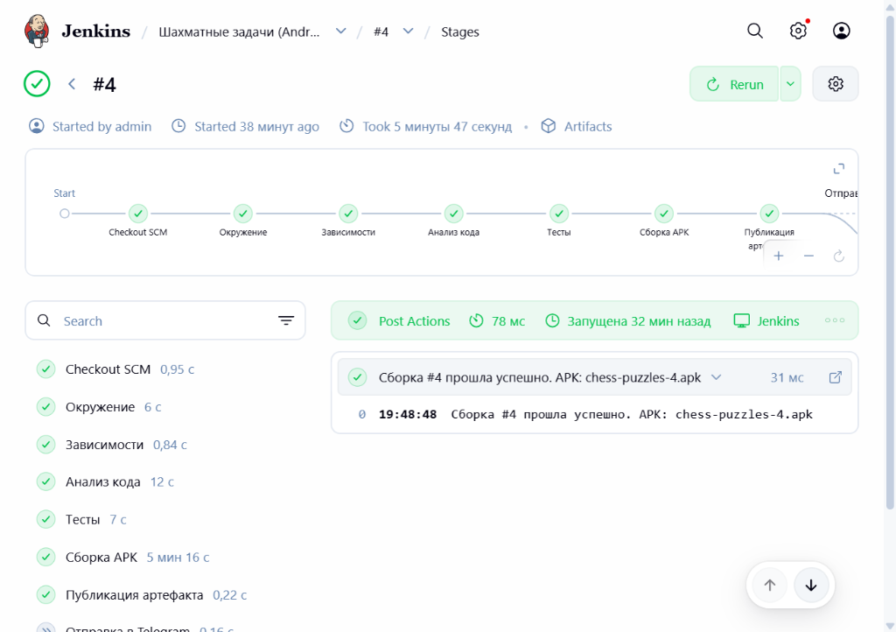
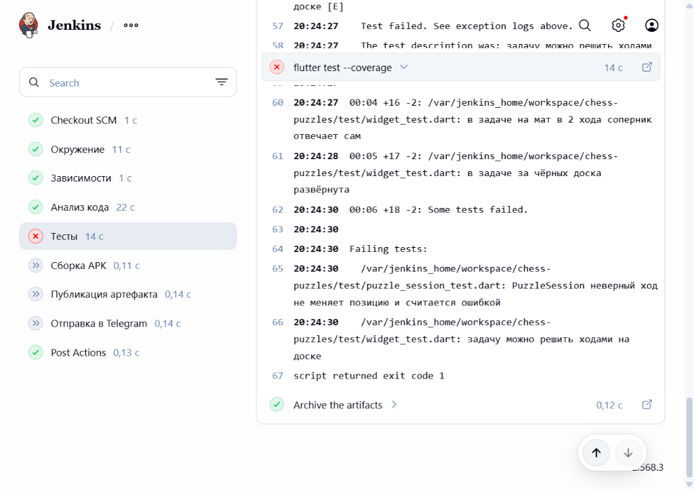

# Конвейер CI/CD для мобильного приложения «Шахматные задачи»

> **Курсовая работа** по дисциплине «Настройка и администрирование сервисного программного обеспечения»  
> **Автор:** студент гр. ИКБО-15-25 Платонов В.  
> **Научный руководитель:** преподаватель Волков М. В.  
> **Учебное заведение:** РТУ МИРЭА, Институт информационных технологий, Кафедра КИС, 2026 г.  

---

## 📌 Описание проекта

Проект представляет собой комплексное инженерное решение по проектированию, настройке и администрированию конвейера непрерывной интеграции и непрерывной доставки (CI/CD) для мобильного приложения под ОС Android (Flutter). 

Сервер автоматизации **Jenkins** полностью изолирован в Docker-контейнере и настраивается по концепции **Infrastructure as Code (IaC)** с помощью декларативных плагинов **JCasC** (Jenkins Configuration as Code) и **Job DSL**.

### Основные компоненты системы:
- **Целевое мобильное приложение:** Flutter-приложение для решения шахматных задач с комплексом из 20 автоматизированных тестов (модульные, логические, виджет-тесты).
- **Сборочное окружение:** кастомный образ Docker (`jenkins/jenkins:2.568.3-lts-jdk21`) с предустановленными Android SDK (API 36, Build-Tools 36.0.0, NDK 28.2) и Flutter SDK 3.47.5 stable.
- **Отказоустойчивая сеть зависимостей:** динамическая инъекция `mirror.init.gradle` в сборочный контейнер для прозрачного перенаправления запросов Maven Central, Google Android Maven и Gradle Plugin Portal на быстрые CDN-зеркала Aliyun (решение проблемы блокировок и сетевых сбоев).
- **Конвейер сборки (`Jenkinsfile`):** сквозной 7-этапный Declarative Pipeline с жестким контролем качества (Quality Gates), версионированием артефактов через `BUILD_NUMBER` и доставкой APK.

---

## 📊 Результаты работы конвейера

### 1. Успешный прогон CI/CD (Сборка #4)
Полный цикл: валидация окружения → установка пакетов → статический анализ кода → 20/20 тестов (генерация `lcov.info`) → компиляция релизного APK (`chess-puzzles-4.apk`, 43.3 МБ) → архивация и публикация.



### 2. Контроль качества (Quality Gate / Негативное тестирование)
Демонстрация работы защитных барьеров конвейера при внесении логической ошибки в метод `tryMove` (`lib/logic/puzzle_session.dart`):



> **Принцип работы ворот качества:** при падении любого из 20 тестов этап «Тесты» завершается с ошибкой (`exit code 1`). Все последующие ресурсоёмкие стадии («Сборка APK», «Публикация артефакта») принудительно пропускаются (`Skipped`), что предотвращает выпуск сломанных версий в релиз и экономит вычислительные ресурсы сервера.

---

## 🏗️ Структура репозитория

```text
chess-puzzles-ci/
├── Jenkinsfile                 # Декларативное описание конвейера CI/CD
├── docker-compose.yml          # Развёртывание сервера Jenkins в Docker
├── .env.example                # Шаблон переменных окружения и учётных записей
├── COURSEWORK_REPORT.pdf       # Пояснительная записка к курсовой работе (ГОСТ 7.32)
├── jenkins/
│   ├── Dockerfile              # Образ Jenkins + Flutter SDK + Android SDK + NDK
│   ├── plugins.txt             # Список необходимых плагинов Jenkins
│   └── casc/
│       └── jenkins.yaml        # Конфигурация Jenkins как код (JCasC + Job DSL)
├── lib/                        # Исходный код мобильного приложения (Flutter / Dart)
│   ├── logic/puzzle_session.dart # Бизнес-логика решения шахматных этюдов
│   ├── models/                 # Доменные модели доски, фигур и задач
│   ├── screens/                # UI-экраны списка задач и шахматной доски
│   └── widgets/                # Кастомные виджеты рендеринга доски
├── test/                       # Набор из 20 автоматизированных тестов
│   ├── board_test.dart         # Тесты валидации ходов и правил
│   ├── puzzle_session_test.dart# Тесты таймера, подсчёта очков и ошибок
│   └── widget_test.dart        # Виджет-тесты интерфейса и переворота доски
├── android/                    # Android-часть проекта (Gradle, Manifest)
└── screenshots/                # Скриншоты конвейера и артефактов
```

---

## 🚀 Быстрый старт и развёртывание

### Системные требования
- **ОС:** Windows 10/11 (WSL 2), Linux или macOS
- **ПО:** Docker Engine 24+ и Docker Compose v2, Git
- **Ресурсы:** 8+ ГБ оперативной памяти, ~25 ГБ свободного места на SSD

*(Установка Flutter SDK, Android Studio или Java на хостовую машину не требуется — сборочное окружение полностью изолировано внутри контейнера).*

### Инструкция по запуску

```bash
# 1. Клонирование репозитория
git clone https://github.com/VasiliiPlatonov/chess-puzzles-ci.git
cd chess-puzzles-ci

# 2. Создание файла переменных окружения
cp .env.example .env
# При необходимости отредактируйте пароль администратора в .env

# 3. Сборка Docker-образа и запуск контейнера в фоне
docker compose up -d --build
```

После завершения инициализации:
1. Откройте панель управления Jenkins: [http://localhost:8080](http://localhost:8080)
2. Авторизуйтесь с логином `admin` и паролем из файла `.env`.
3. Конвейер **«Шахматные задачи (Android)»** генерируется автоматически через Job DSL и готов к работе.
4. Каждые 5 минут конвейер опрашивает GitHub-репозиторий и запускает новую сборку при обнаружении свежих коммитов.

---

## 🛠️ Администрирование и Disaster Recovery

### Основные команды управления сервисом

| Действие | Команда |
| :--- | :--- |
| Проверка статуса контейнера | `docker compose ps` |
| Просмотр журнала событий Jenkins | `docker compose logs -f jenkins` |
| Перезапуск сервиса | `docker compose restart jenkins` |
| Корректная остановка | `docker compose down` |
| Очистка неиспользуемых слоёв Docker | `docker system prune -f` |

### Резервное копирование (Backup)
Резервное копирование конфигурации и сборок Jenkins выполняется горячим архивированием Docker-тома с фильтрацией временных кэшей:

```bash
docker run --rm -v chess-puzzles-jenkins-home:/data -v ${PWD}:/backup alpine \
  tar czf /backup/jenkins_backup.tar.gz --exclude=./.gradle --exclude=./.pub-cache --exclude=./workspace -C /data .
```

### Аварийное восстановление (Disaster Recovery)
Восстановление сервиса на новом хосте или после сбоя диска:

```bash
docker compose down
docker run --rm -v chess-puzzles-jenkins-home:/data -v ${PWD}:/backup alpine \
  sh -c "rm -rf /data/* && tar xzf /backup/jenkins_backup.tar.gz -C /data"
docker compose up -d
```

---

## 📦 Стек технологий и версионирование

| Компонент | Версия / Спецификация | Назначение |
| :--- | :--- | :--- |
| **Jenkins LTS** | `2.568.3` (Java 21) | Сервер автоматизации CI/CD |
| **Flutter SDK** | `3.47.5` (channel stable) | Фреймворк мобильной разработки |
| **Android SDK** | API Level 36, Build-Tools 36.0.0 | Среда компиляции Android-приложения |
| **Android NDK** | `28.2.13676358` | Набор инструментов для нативного кода |
| **Gradle / AGP** | Gradle `9.3.1` / AGP `9.1.0` | Сборочная система Android-модуля |
| **JCasC & Job DSL** | `1.97` / `1.93` | Реализация концепции Infrastructure as Code |
| **Docker / Compose** | Engine 27+ / Compose v2.30+ | Контейнеризация и оркестрация сервиса |

---

## 📄 Документация

- [COURSEWORK_REPORT.pdf](COURSEWORK_REPORT.pdf) — Пояснительная записка к курсовой работе по ГОСТ 7.32-2017 (20 с., 15 источников по ГОСТ 7.0.5-2008).

